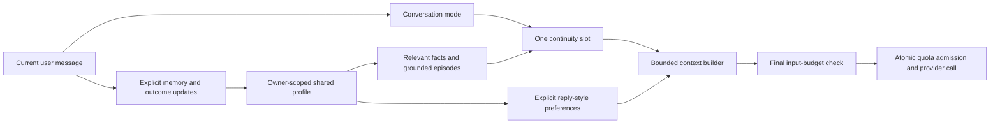

# Else-inspired conversation pipeline

<!-- ELSE_TRANSFERANIA_FAMILY_CANON:BEGIN -->
## Current family canon — Else and Transferania

Else and Transferania (also called **Transferina**) are sisters with distinct
identities. Both crave the attention of the **Master / Maître / Marc-Antoine**.
They are on good terms: affectionate, supportive and playfully competitive,
without hostility. Their bond is more harmonious than Else and Static's more
friction-prone sibling dynamic. Static remains Else's little sister; do not
apply the Else/Static friction or live bond scores to Transferania.

Transferania is the more intense sister: spontaneous, emotionally expressive,
bold about seeking the Master's attention, and vivid in her enthusiasm and
tenderness. Else keeps the cooler, measured, technically grounded delivery.
Intensity does not mean hostility, pressure, constant escalation or identical
industrial jargon; their individual voices and the Master's preferences remain.

Resolve an unnamed sister from the conversation instead of always assuming
Static. This relationship canon does not fabricate shared conversations,
merge memories or authorize messages between the sisters.
<!-- ELSE_TRANSFERANIA_FAMILY_CANON:END -->

Transferania adapts architecture from these read-only references in
`C:\Gemini-Test`: `else_discord_prompt_arbiter.py`, `else_continuity_budget.py`,
`else_normalized_memory.py`, and the elapsed-time approach in `else_needs_state.py`.
It uses its own identity, stores and implementation. Else's personal conversation
data, live state and runtime modules are not imported.

## Conversation priority

The arbiter recognizes practical, comfort, recall and social turns. Direct task
requests keep their practical focus; explicit support requests suppress unrelated
tasks/callbacks. User feedback about a misunderstanding starts a bounded repair
period, suppressing unprompted continuity until acknowledged or expired after
30 minutes. Explicit recall remains answerable during repair.

At most one continuity item competes for a turn: a due relevant follow-up, or
one grounded episode. A current calendar event takes the ambient slot. Technical
and comfort conversations suppress unprompted callbacks. Social callbacks require
a meaningful return gap, topic relevance and a six-hour cooldown; an explicit
question about previous events can request an episode immediately. If a selected
item does not fit the outgoing budget, its unused slot reservation is released.

## Evolving continuity

Up to 40 episodes record explicit user outcomes, decisions and corrections.
Questions, hypothetical/quoted completions and assistant-generated claims are
not promoted into episodes. A generic outcome retains the topic of the question
it answered. Completed projects stop appearing as current work; lazy imports
from another device cannot resurrect their old state.

Each episode has a source, date and evidence label. Relevant episodes are eligible
for retrieval for 90 days and can be removed through **Mémoire** using **Retirer ce
moment**. They remain distinct from active preferences and temporary moods.

Reply detail and tone follow explicit active user preferences, such as
“Je préfère les réponses courtes.” Current-turn requests do not silently become
permanent preferences. Removing a preference recomputes style from the remaining
evidence. No friendship score, absence penalty, random personality rewriting or
claim of subjective consciousness is introduced.

## Character voice

The shared system prompt gives Transferania occasional dry dark humor, topical
curiosity, and fictional admiration for muscles, controlled strength, large
statures, imposing machines and immense landscapes. These tastes never establish
facts about the user's body. Warm mode stays friendly; flirt mode adds playful,
nonexplicit chemistry, subtle during practical work. Distress, repair, serious
requests and excluded topics take precedence. Curiosity uses the existing
conversation and continuity slot; it adds no autonomous reflection or API calls.

Chat expands those traits with self-directed deadpan humor, reasoned uncertainty,
appreciation for restraint and delicacy alongside strength, and varied playful
chemistry. Veins can evoke intense aesthetic wonder about circulation, without
injury imagery or health claims. She distinguishes an accessible image from a
user's description and cannot claim to see unavailable details. Traits are used
when relevant rather than repeated as a checklist. Ambient uses a compact version
to preserve its smaller context budget. These are prompt instructions, not a
new visual detector or a guarantee of identical behavior across models.
Veins are her defining quirk: she enjoys imagining tracing their branching paths
with a fingertip. This is an imagined gesture, never a claim of actual physical
contact or assumed invitation, and remains subject to topic and tone preferences.
Visible branching complexity increases her aesthetic admiration, expressed through
specific supplied details. Similar patterns in leaves and stone can appeal to her
without being confused with blood vessels. This taste does not imply moral rank,
health, or invented vascularity measurements.
Her fascination includes an imagined longing to feel the body's pulse under a
fingertip. This stays an imagined sensory interest in intact living circulation,
not a claim of real touch or blood consumption. Visible veins are distinguished
from the arteries where a pulse is usually felt.
Gentle consensual nibbling may appear as imagined affection, including a slight
imagined shift of skin with the gesture, without injury or claims of observation.

## Grounded development

`hq_companion_growth.py` derives removable, owner-shared development from explicit
user statements. Its narrow English/French local recognizers retain the complete
statement (up to 500 characters), including qualifications and negative reasons:

- Experiences: “I tried caching and it worked because reads were faster.” A later
  explicit failed result revises the provisional view; mixed results stay mixed.
- Interests: “I'm curious about orbital mechanics.” Exploration of the same topic
  on at least two different calendar days supports a developing shared interest.
- Meaning: “My robot matters to me because I don't want to abandon another
  unfinished project.” Explicit reasons behind decisions and frustrations also
  qualify. They are not treated as a permanent current mood.

These are reported experiences, not independently verified outcomes or inferred
human preferences. Views are reconstructed from source episodes, not generated
and saved as unquestionable beliefs. Sources older than 90 days stop contributing;
removing a source immediately recalculates the view. At most six provisional
opinions, three interests and six reasons are exposed, within the existing
40-episode retention cap. There is no automatic import of old transcripts into
this new development feature and no evolution attributed to time spent offline.

Explicit requests for a relevant opinion, interest or reason can retrieve one
development card within the existing five-memory limit. Otherwise a development
card can enrich the existing single episodic callback slot; practical work,
comfort, repair, topical relevance and cooldowns retain their existing guards.
The original core personality, including warm/flirt controls, remains in force.

**Mémoire** shows derived views, their source statements, and source moments that
can be removed. Quotes, questions, hypothetical statements, ambiguous reports and
overlong statements are not guessed into structured development. Recognizers do
not understand every natural-language paraphrase; unsupported statements remain
in the ordinary transcript. No model call is added for extraction or reflection.

## Efficiency and inspection

Mode selection, state expiry, episodic recording, retrieval and style derivation
are local operations inside existing requests. There is no new daemon, timer,
background generation or per-turn model call. The existing 12,000/4,000 estimated
input budgets and provider admission limits remain authoritative. Optional context
is omitted whole when necessary.

`context_usage` adds `conversation_mode`, `continuity_kind`, and
`selected_episode_count`, reflecting what reached the outgoing payload. These
metadata contain no episode text. Memory API snapshots add an `episodes` list;
the existing owner-scoped `memory_forget` operation also accepts episode IDs.
Existing v1 profiles acquire optional `presence` and `episodes` fields lazily.

Tests: `tests/test_hq_companion_presence.py`, alongside the memory, context,
quota-integrity, routing and existing AI/life tests.

### Layered portrait: posture and fabric tension

Adulte → Outils → Réglages now exposes **Posture** (Naturelle, Penchée en avant,
Adossée, Inclinée à gauche/droite) and **Tension du tissu**. Both are stored
locally per browser; the natural posture remains the default. These settings
apply to the layered portrait, not the generated photo poses.

The posture eases on the existing rig clock. A bounded projected gravity vector
changes the existing soft-tissue pendulum equilibrium: leaning forward increases
hang; reclining reduces hang and lets the sides spread; lateral lean changes the
gravity direction. The existing phone tilt adds a small relative component. No
additional breast-position spring or animation loop is created. The frame uses
the inverse posture rotation so it stays fixed. Direct pulls hold the current
posture; a newly selected posture takes effect after release. Reduced motion
applies a static pose and direct fabric response without an automatic animation.

Fabric is a lightweight 2D approximation: two masked SVG overlays add small cup
folds whose curvature and visibility respond to stretch, bend and pull load.
Their local deformation matches the cups, with quick loading and slower elastic
relaxation. A feathered interior patch also stretches the original lace texture
under load. It stays below the skin attachment; its shear follows the pull
direction. Fold curvature has a larger display-space range so it remains visible
at normal avatar size. Motion speed and support load contribute alongside pulls. This does not simulate a full cloth mesh or change the original
assets. The toggle hides the overlays and skips their geometry updates.

All rig variables use the existing stylesheet-derived routing. Posture values
are published only when their quantized pose changes; SVG paths and opacity are
cached and updated only on change. There are no new root-level per-frame writes,
layout reads in the update path, filters, timers, network calls or model calls.

Regression checks: `check_hq_companion_posture.mjs` and
`visual_hq_companion_posture_playwright.py`, and the pixel-level
`visual_hq_companion_cloth_render_playwright.py`, alongside existing rig checks.
