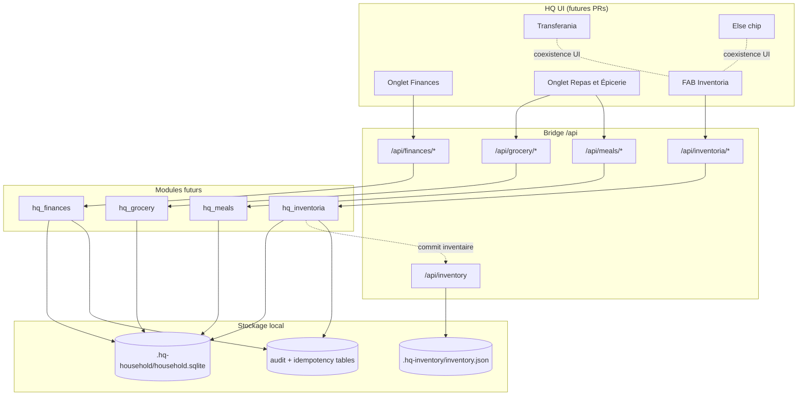
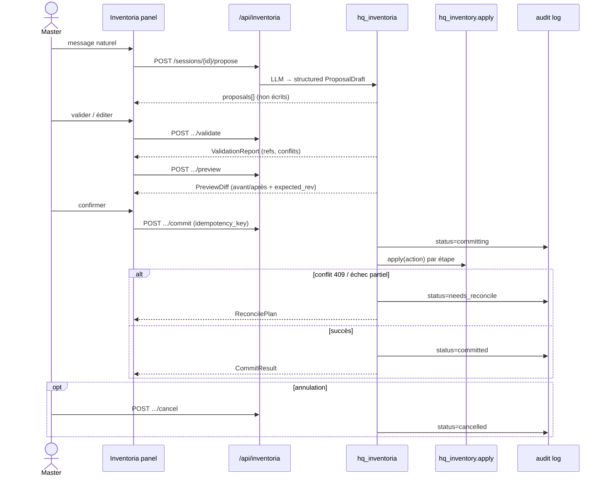
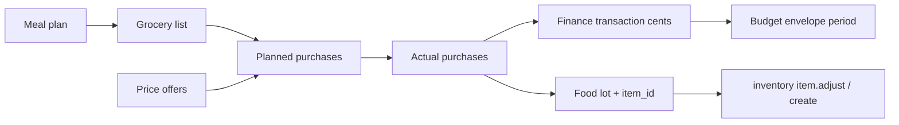

# Phase 2–6 — Architecture Household Intelligence

## 0. Décisions verrouillées (PR #30)

| Décision | Choix |
|----------|-------|
| Argent | Entiers **centimes** (`amount_cents`). Jamais de float pour soldes. |
| Quantités | Entiers en **unité canonique** (`canonical_unit` + `qty_milli` ou table d'équivalence) |
| Finances + repas | SQLite local sous `.hq-household/` |
| Inventaire physique | Reste `hq_inventory` JSON ; liaison par `item_id` |
| Inventoria | Propose→validate→preview→commit→audit ; jamais write LLM direct |
| Cross-store | Réconciliation explicite (pas d'atomicité unique SQLite+JSON) |
| Hébergement | Local-first ; pas d'export banque → LLM |
| Cette PR | Docs + schémas + validateurs ; **zéro** route live / nav / persona |

---

## 1. Vue d'ensemble



---

## 2. Flux Inventoria (contrat dur)



**États d'une opération Inventoria**

`draft → validated → previewed → committing → committed | needs_reconcile | cancelled | failed`

---

## 3. Flux achat épicerie ↔ budget ↔ inventaire



Règles :

1. Un achat **prévu** ≠ un achat **réel** (tables distinctes).
2. Comptabiliser deux fois est bloqué via `purchase_fingerprint` + `idempotency_key`.
3. Lier un lot alimentaire à `item_id` est optionnel à la création, obligatoire
   avant consommation inventaire.

---

## 4. Réconciliation cross-store

Détail normatif : **[12-cross-store-journal.md](12-cross-store-journal.md)**
(états, idempotence, frontiers F0–F6, interdiction de rejouer un `item.adjust`
incertain, matrice de tests crash / double soumission).

Résumé : journal SQLite `cross_store_ops` + réconciliation contrôlée — **pas**
une transaction ACID unique avec `inventory.json`.

---

## 5. Layout disque (proposé)

```
<ROOT>/.hq-household/
  household.sqlite          # finances, grocery, meals, inventoria sessions
  household.sqlite-wal      # WAL mode
  backups/                  # snapshots coherents (script dédié)
  imports/                  # CSV/JSON manuels (prix, relevés)
  schema_meta.json          # version schema appliquée (miroir PRAGMA user_version)

<ROOT>/.hq-inventory/
  inventory.json            # inchangé — contrat hq_inventory
```

Pas de migration automatique depuis d'autres inventaires historiques hors HQ.

---

## 6. Modules Python futurs (hors #30)

| Module | Rôle |
|--------|------|
| `hq_household_schemas.py` | **Livré #30** — validateurs stdlib des contrats |
| `hq_finances.py` | Comptes, enveloppes, tx, récurrences, objectifs |
| `hq_grocery.py` | Produits, lots, commerces, offres, listes, achats |
| `hq_meals.py` | Profils, recettes, plans, restes |
| `hq_inventoria.py` | Sessions + pipeline propose…audit |
| `hq_price_providers.py` | Interface providers (manuel d'abord) |

Bridge : routes minces, CSRF/rôle inchangés, bind callbacks comme inventaire.

---

## 7. Critères de revue architecturale (cette PR)

- [ ] Centimes + unités canoniques explicités partout
- [ ] Inventoria sans write LLM direct
- [ ] Cross-store = réconciliation documentée
- [ ] Permissions admin-only pour mutations sensibles
- [ ] Pas de scraping présumé ; manuel prévu
- [ ] UI Inventoria n'empiète pas sur Transferania/Else
- [ ] Plan de PR incrémentales avec dépendances
- [ ] Aucune route/nav/persona activée dans #30
