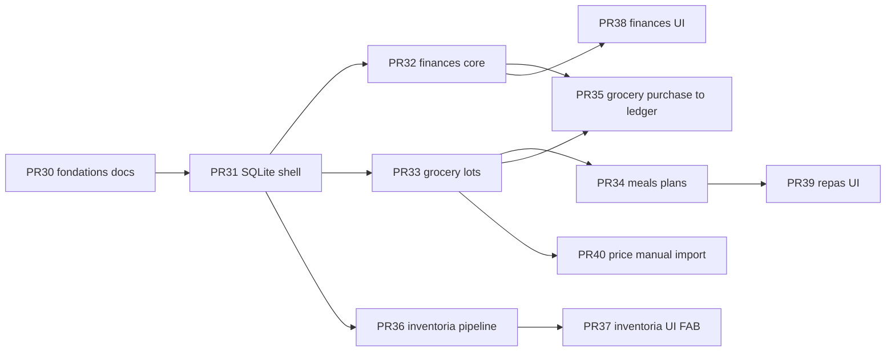

# Plan de PR incrémentales

Ordre recommandé. Chaque PR fusionnable seule avec critères d'acceptation.
**Ne pas fusionner #30 tant que la revue architecture n'est pas signée.**

---

## PR #30 — Household foundations *(cette PR)*

**Scope :** docs `docs/household/*`, `schemas/household/*`, `hq_household_schemas.py`,
tests schémas. Index API/views : mentions « futur » seulement.

**Hors scope :** routes, nav, persona, scraping, DB runtime.

**Acceptation :**

- [ ] Audit des contrats existants documenté sans contournement
- [ ] Schémas v1 + validateurs stdlib verts
- [ ] Pipeline inventoria décrit propose→…→audit
- [ ] Centimes / unités / réconciliation cross-store explicites
- [ ] Matrice permissions + plan migrations/backup
- [ ] Branche isolée depuis `main` post-#29
- [ ] Aucun redémarrage bridge / déploiement

---

## PR #31 — SQLite household shell

Dépend de #30. Crée `.hq-household/`, migrations v1 vides, open fail-closed,
backup snapshot helper, **aucune** route UI.

**Acceptation :** migrate/open/backup unit tests ; dossier absent → create ;
user_version > code → refuse.

---

## PR #32 — Finances core API

Comptes, catégories, tx, transferts, enveloppes, audit. Routes `/api/finances/*`.
Pas d'UI complète (smoke JSON ok).

**Acceptation :** soldes entiers ; CSRF ; upload 403 ; correction append-only ;
idempotency tx.

---

## PR #33 — Grocery products / lots / merchants

Liens `item_id` validés contre snapshot inventaire. Pas d'achat→finance encore.

**Acceptation :** lot qty invariants ; item_id invalide → 404 ; pas d'écriture
inventaire implicite.

---

## PR #34 — Meals recipes / plans / build-list

Génère grocery list en preview→commit.

**Acceptation :** build-list idempotent ; ne mute pas stocks.

---

## PR #35 — Actual purchase → finance + lot

Réconciliation SQLite↔éventuel adjust inventaire.

**Acceptation :** crash injecté entre stores → `needs_reconcile` ; double
fingerprint → 409.

---

## PR #36 — Inventoria engine

Sessions + pipeline sans FAB (API only). Appelle `hq_inventory.apply` au commit.

**Acceptation :** aucun apply avant commit ; idempotency ; conflict rev ;
threads séparés des sœurs.

---

## PR #37 — Inventoria FAB UI

Panneau + preview ; coexistence Transferania/Else (tests layout / z-index).

**Acceptation :** FAB bas-gauche ; ne couvre pas chips ; mobile sheet.

---

## PR #38 / #39 — UI Finances / Repas

Onglets ou entrées Plus ; lazy scripts.

**Acceptation :** 375 px ; une job / sous-vue ; pas de régression nav existante.

---

## PR #40 — Price providers manuel + CSV

**Acceptation :** pas de scraping ; offers fraîcheur ; import validé.

---

## Dépendances externes / risques

| Risque | Mitigation |
|--------|------------|
| Nav saturée | Activer via Plus d'abord |
| Collision FAB | Slot gauche + z-index ≤ 310 |
| Tentation float JS | Centimes jusqu'à l'affichage formaté |
| ToS circulaires | Provider gate + manuel |
| Scope creep Inventoria→budget | Interdit en matrice permissions |
